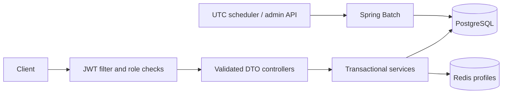

# Banking Transaction Management System

A Java 21, Spring Boot 3.5 modular monolith demonstrating authenticated banking APIs, PostgreSQL transactions, retry-safe money transfers, Redis caching and Spring Batch reporting. Maven builds one executable backend JAR. No frontend is included.

## Architecture

Packages follow business features: `auth`, `account`, `transfer`, `ledger`, `report`, and `admin`. Each feature owns its controllers, services, repositories, DTOs, entities and explicit mappers where needed. `security`, `config` and `common` contain shared infrastructure. Controllers validate and translate HTTP; services define transaction boundaries and business rules; repositories perform persistence. Entities never cross the API boundary.



| Table | Purpose |
|---|---|
| `app_users` | Normalized unique email, BCrypt password, server-managed role |
| `accounts` | Immutable owner, INR currency, exact decimal balance |
| `transfer_requests` | User-scoped unique retry key, canonical payload hash, status, receipt fields |
| `transactions` | Immutable DEBIT and CREDIT ledger entries, resulting balance |
| `daily_reports` | Per-UTC-day totals and ledger entry count |
| `batch_*` | Durable job instances, executions, step state and restart metadata |

PostgreSQL foreign keys, positive-amount checks, nonnegative-balance checks and unique constraints backstop application rules. Flyway owns both business and Batch schemas; Hibernate validates them. Owner/date, account/date and global ledger date indexes support common queries. UUID references are mapped as scalar IDs, so DTO mapping cannot accidentally trigger lazy relationship fetches or N+1 queries. Open Session in View is disabled.

## Run locally

Prerequisites: JDK **21**, Maven 3.9+, Docker with a running Linux engine. PostgreSQL 17 and Redis 7.4 are provided by Compose. Set `JAVA_HOME` to your JDK 21 installation and verify `java -version` and `mvn -version` first.

Local settings belong in `.env`, beside `compose.yaml`; `.env.example` is only a template. Both Compose and Spring Boot load `.env` when started from the project root. Process environment variables override file values. The PowerShell startup script loads `.env` into its process first, so old terminal port settings cannot override the project's local settings.

PowerShell:

```powershell
# If .env has already been configured, start everything with:
powershell -ExecutionPolicy Bypass -File .\scripts\start-local.ps1
```

For a fresh checkout, copy `.env.example` to `.env`, replace its password placeholder, and replace its JWT placeholder with 32 random bytes encoded as Base64 before running the script. Keep the existing database password if the PostgreSQL volume was already initialized; changing the file does not reset a stored database password. No manual schema creation is needed. The script starts and health-checks PostgreSQL/Redis, then runs the backend in the foreground; Ctrl+C stops the backend. It does not delete database volumes.

Bash:

```bash
cp .env.example .env
# Edit .env with your DB_PASSWORD. Export the same value:
export DB_PASSWORD='choose-a-local-db-password'
export JWT_SECRET="$(openssl rand -base64 32)"
docker compose up -d --wait
mvn clean verify
mvn spring-boot:run
```

Alternatively, `mvn package -DskipTests` and `java -jar target/banking-1.0.0.jar` with the same environment. `mvn test` runs fast unit tests; `mvn verify` also runs integration tests and requires Docker. Integration tests start their own isolated PostgreSQL container and do not use your Compose database.

- API: `http://localhost:8084/api`
- Swagger UI: `http://localhost:8084/swagger-ui.html`
- OpenAPI JSON: `http://localhost:8084/v3/api-docs`
- Health: `http://localhost:8084/actuator/health`

| Environment variable | Default / requirement |
|---|---|
| `DB_URL` | `jdbc:postgresql://localhost:5433/banking` |
| `POSTGRES_PORT` | Compose host port `5433`; container PostgreSQL still uses `5432`. If changed, update `DB_URL` to match. |
| `DB_USERNAME` | `banking` |
| `DB_PASSWORD` | Required |
| `JWT_SECRET` | Required; base64 encoding of at least 32 random bytes |
| `REDIS_HOST`, `REDIS_PORT` | `localhost`, `6380`; local Compose fixes host port `6380` to container port `6379`, independent of stale terminal variables. Keep `.env` at `REDIS_PORT=6380`. |
| `REDIS_PASSWORD` | Empty for local Compose |
| `PORT` | `8084` |
| `REPORT_CRON` | `0 5 0 * * *`, interpreted in UTC; `-` disables scheduling |

`.env` and generated output are gitignored. Compose binds data services to loopback for local development. For other environments, provide secrets externally, use TLS, restrict database/Redis access, and run with managed backups and monitoring. No credentials or signing key are built into application defaults.

## Demo data

1. Register `alice@example.test`, `bob@example.test`, and `admin@example.test` through `POST /api/auth/register`, using passwords at least 12 characters long.
2. Apply the **development-only** fixture after Flyway has run:

   ```powershell
   Get-Content scripts/seed-demo.sql -Raw | docker compose exec -T postgres psql -v ON_ERROR_STOP=1 -U banking -d banking
   ```

   Bash equivalent: `docker compose exec -T postgres psql -v ON_ERROR_STOP=1 -U banking -d banking < scripts/seed-demo.sql`.
3. Log in as Alice and admin. Use the resulting tokens in `examples/banking.http` or Swagger's Authorize dialog.

Alice's fixture account is `11111111-1111-1111-1111-111111111111` with INR 10,000. Bob's is `22222222-2222-2222-2222-222222222222` with INR 2,000. Reapplying the fixture does not reset balances. Opening funding is a documented development fixture, outside the transfer ledger. Newly created accounts always have a zero balance. External deposits, withdrawals and privileged account funding workflows are intentionally outside this project's scope.

Public registration always creates CUSTOMER; clients cannot choose a role. Admin provisioning is an operator database action, demonstrated by the fixture. JWT authentication reloads the user and current role from PostgreSQL, so role changes apply without waiting for token expiry.

## API reference

Except authentication, documentation and basic health, requests require `Authorization: Bearer <JWT>`. Tokens expire after 15 minutes; log in again to obtain a new token. Passwords use BCrypt cost 12; registration rejects passwords over BCrypt's 72 UTF-8-byte limit.

| Method | Endpoint | Access / behavior |
|---|---|---|
| POST | `/api/auth/register` | Register CUSTOMER; returns token, 201 |
| POST | `/api/auth/login` | Authenticate; returns token |
| POST | `/api/accounts` | Create an account for the caller, 201 |
| GET | `/api/accounts` | Caller's accounts, paginated |
| GET | `/api/accounts/{id}` | Owner or ADMIN; live database balance |
| GET | `/api/accounts/{id}/profile` | Owner or ADMIN; cacheable nonfinancial profile |
| PATCH | `/api/accounts/{id}/profile` | Owner or ADMIN; change display name |
| POST | `/api/transfers` | Caller must own source; required `Idempotency-Key` |
| GET | `/api/accounts/{id}/transactions` | Owner or ADMIN; pageable date-filtered ledger |
| GET | `/api/accounts/{id}/statement` | Owner or ADMIN; required `from`, `to` |
| GET | `/api/admin/accounts` | ADMIN; pageable accounts |
| GET | `/api/admin/transactions` | ADMIN; optional `accountId`, `from`, `to` |
| POST | `/api/admin/reports/daily/{date}/run` | ADMIN; manually execute Batch job |
| GET | `/api/admin/reports/daily/{date}` | ADMIN; persisted summary |
| GET | `/api/admin/reports/daily/{date}/csv` | ADMIN; download CSV |

Transfer request:

```http
POST /api/transfers
Authorization: Bearer <alice-token>
Idempotency-Key: payment-2026-001
Content-Type: application/json

{"sourceAccountId":"11111111-1111-1111-1111-111111111111","destinationAccountId":"22222222-2222-2222-2222-222222222222","amount":125.50}
```

The response contains the transfer ID, source/destination IDs, amount, `COMPLETED` status and completion timestamp. Successful first requests and replays return 200 with the same receipt. Even an admin cannot spend from an account they do not own.

Pagination: zero-based `page`, `size` (maximum 100), repeated `sort=field,direction`; default ordering is `createdAt,desc` with an ID tie-breaker. Account sorting allows `id`, `createdAt`, `displayName`; transaction sorting allows `id`, `createdAt`, `amount`, `type`. Other sort fields return 400. Responses contain `content`, `page`, `size`, `totalElements`, `totalPages`.

Date filters use ISO-8601 instants, for example `from=2026-11-01T00:00:00Z&to=2026-12-01T00:00:00Z`. Ranges are **inclusive from, exclusive to**. Statement totals and opening/closing balances cover the entire range; only entries are paginated. Statements use a repeatable-read snapshot so entries, aggregates and balances agree during concurrent writes. Opening/closing balances are derived from current database balance and subsequent ledger deltas, preserving fixture opening funding.

## Transaction and locking strategy

`TransferService.transfer` runs at PostgreSQL READ COMMITTED in one `@Transactional` boundary:

1. Validate amount, distinct accounts and key format; canonicalize amount to two decimals and hash source ID, destination ID and amount with SHA-256.
2. Return an existing matching completed receipt if present. Otherwise verify source ownership using scalar existence queries. This avoids preloading a stale account entity into the JPA persistence context before locking.
3. Reserve `(user_id,idempotency_key)` through `INSERT ... ON CONFLICT DO NOTHING`.
4. Lock both accounts in deterministic Java UUID order using PostgreSQL `SELECT ... FOR NO KEY UPDATE`. Always acquire locks in this order, including opposite-direction transfers.
5. Recheck ownership, debit, credit, insert exactly one DEBIT and one CREDIT ledger entry, mark the reservation COMPLETED, then flush.
6. Commit everything together. Business failures, SQL failures and commit failures roll back both balances, ledger and reservation. The response is delivered after the transaction interceptor commits.

Pessimistic locking is a deliberate choice for a contended monetary resource: the second writer waits and then reads the latest committed balance rather than failing an optimistic version check and requiring a service-level retry. `NO KEY UPDATE` serializes balance writers while allowing the foreign-key `KEY SHARE` locks acquired during reservations; stronger `FOR UPDATE` can cause avoidable lock upgrades/deadlocks with these references. Primary keys and ownership are immutable in the API. PostgreSQL documents the lock compatibility in its [explicit locking reference](https://www.postgresql.org/docs/17/explicit-locking.html).

The datasource sets a 10-second PostgreSQL lock timeout; transfers have a 30-second transaction timeout. Lock contention returns a retryable 409 when translated by Spring. Retry using the **same** key. Database check constraints also prevent negative balances and decimal columns provide exact arithmetic. Balances are never read from Redis for transfers.

## Idempotency semantics

- Keys are scoped to the authenticated user, match `[A-Za-z0-9._:-]{1,128}`, and are retained indefinitely in this sample. A retention policy must preserve the required replay window before any cleanup is introduced.
- PostgreSQL's unique constraint is the authority, across multiple application instances. There is no JVM-local mutex or Redis lock.
- Concurrent inserts for the same key wait for the first transaction. If it commits, the second reads its receipt; if it rolls back, the second can acquire the key and perform the operation. READ COMMITTED gives the subsequent SELECT a fresh snapshot.
- Reusing a committed key with a different source, destination or normalized amount returns 409 `IDEMPOTENCY_CONFLICT`. `30.0` and `30.00` have the same fingerprint.
- PROCESSING is created inside the financial transaction and is not normally visible externally; COMPLETED and its receipt become visible atomically with the balances. Failed requests roll back the reservation and are retryable. This intentionally does **not** persist failed business attempts as durable idempotency outcomes; the key can be retried after funding changes.
- A lost HTTP response after commit is safe: replay returns the original receipt without a second debit. No network call occurs inside the transfer transaction.
- Completion timestamps are normalized to PostgreSQL microseconds before persistence, so the initial receipt and a database-backed replay have identical timestamp precision.

## Redis, logging and security

Spring Data Redis caches only account ID, owner ID, display name and currency for five minutes. Authorization always consults PostgreSQL, even on cache hits. Profile changes evict after successful commit. Profile caching is best-effort: failures fall back to PostgreSQL, and a failed eviction or read/write race may leave an old display name until TTL expiry. Profiles are advisory; balances and credentials are never cached. A stricter cache-consistency requirement would call for versioned keys or a reliable invalidation mechanism.

The custom `OncePerRequestFilter` validates HMAC-SHA256 signature, issuer and expiry using Spring Security's JWT decoder, then loads the current user. Endpoint rules protect admin URLs and method rules protect controllers/admin services. Ownership is enforced in services. Sessions, form login and HTTP Basic are disabled. CSRF is disabled because authentication uses explicit bearer headers rather than ambient cookies. No cross-origin browser policy is opened by default.

The timing aspect records operation name, success/failure and elapsed time without arguments or return values. Transfer completion logs run after commit and contain only the opaque transfer ID. Error handling avoids returning SQL, exception internals or rejected passwords. Hibernate SQL exception logging is disabled because PostgreSQL constraint errors can include entire rejected rows, including financial data or password hashes. The rollback test verifies that these details are absent from application logs. Request-body/header logging must remain disabled in external proxies, and database-server logging needs its own access and redaction policy.

## Batch reports

The tasklet aggregates in PostgreSQL rather than loading a day's ledger into memory. It stores total debits, total credits and ledger-entry count. One transfer contributes **two** transactions: one debit and one credit. CSV export reads the persisted report and includes only totals, not account details.

The scheduler runs at 00:05 UTC for the preceding UTC day. Manual execution accepts only a completed UTC day. `date` is the identifying Batch job parameter; repeated successful runs return `ALREADY_COMPLETED`, failed runs can restart, and the unique report date plus upsert protects persistence. The synchronous launcher returns after completion. Database job metadata prevents duplicate instances across app instances. Reports capture committed data at query time. The five-minute scheduling delay allows normal in-flight transfers to settle; a manual run immediately after midnight can omit a previous day's still-uncommitted transaction. Late commits or external backdated ledger writes require reconciliation. Production scheduling also needs monitoring for missed days and a deliberate reconciliation/rebuild process.

## Errors

All API error bodies have `timestamp`, `status`, `code`, `message`, `path`.

```json
{"timestamp":"2026-11-14T08:00:00Z","status":409,"code":"INSUFFICIENT_BALANCE","message":"Insufficient balance","path":"/api/transfers"}
```

Common statuses: 400 invalid input, 401 missing/invalid credentials, 403 ownership/role violation, 404 account/report absent, 409 insufficient funds/key conflict/constraint conflict/resource busy, 500 unexpected failure. Validation responses deliberately avoid echoing rejected values. Custom exceptions include insufficient balance, missing account, unauthorized account access and duplicate-key payload reuse.

## Testing and verification

- JUnit 5 account tests cover exact arithmetic, rejected amounts and overdraft protection.
- Mockito service tests verify early validation and unauthorized-source rejection without ledger writes.
- PostgreSQL Testcontainers integration tests cover schema startup, successful transfers and replay, insufficient funds with retry, database-induced rollback, changed-payload key reuse, concurrent debits, concurrent same-key requests and opposite-direction locking.
- MockMvc tests cover registration/login, real JWT use, malformed JWTs, validation, account ownership and admin restrictions.
- Batch integration tests verify persisted totals and completed-job replay behavior.

Run `mvn test` for unit tests and `mvn clean verify` for all tests. Integration tests intentionally fail when Docker is unavailable rather than silently skipping transaction verification. The suite starts isolated PostgreSQL and Redis containers, verifies profile cache contents and post-commit eviction, and checks statement totals independently of pagination. Testcontainers 1.21.4 supports the newer Docker Engine API baseline.

Verification results for this workspace are recorded in `VERIFICATION.md`.

## Scope and interview discussion

This is a production-style learning backend, not a licensed banking platform. Deliberate boundaries include a single currency, no external payment rails, no refresh/revocation token store, no account deletion/owner changes, no interest/fees, no KYC workflow and no full double-entry general ledger. Further production work would include rate limits for authentication, audit retention, customer identity controls, reconciliation, tested recovery procedures, metrics and secret rotation. These belong to explicit requirements rather than hidden scaffolding in this modular monolith.

Useful walkthrough topics: why locks must precede entity loading; foreign-key lock compatibility; flush versus commit; why unique constraints are necessary for idempotency; retry behavior after rollback; why cached balances are unsuitable; statement snapshot isolation; and why paired account ledger entries are not by themselves a full general ledger.

Framework reference: [Spring Boot 3.5 system requirements](https://docs.spring.io/spring-boot/3.5/system-requirements.html), [Spring Batch JobRepository](https://docs.spring.io/spring-batch/reference/5.2/job/configuring-repository.html).
